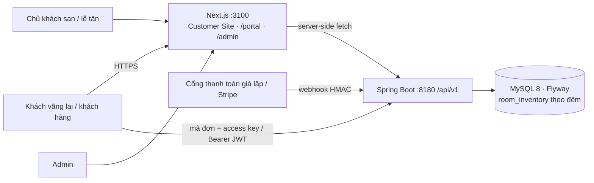

# Kiến trúc

Cùng khuôn với POC Tour: backend 4 lớp theo module (`presentation → application → domain`, `infrastructure` cài đặt), cùng `ApiResponse`, JWT xoay vòng, `PaymentGateway`, `TimeProvider`/đồng hồ demo, audit, thông báo.

## Khác biệt so với Tour
| Chủ đề | Cách làm |
|---|---|
| Tồn kho | `room_inventory(room_type_id, stay_date)`; đặt phòng `INSERT IGNORE` đủ các đêm rồi `SELECT … FOR UPDATE ORDER BY stay_date` |
| Thứ tự khoá | `room_type → room → room_inventory (ngày tăng dần) → booking → payment`; hai khoá đầu chỉ dùng khi thêm/tắt phòng và check-in |
| Đọc trước khi khoá | Kiểm quyền và lấy id bằng projection (`BookingRef`), không nạp entity trước khi khoá |
| Isolation | READ COMMITTED |
| Đa bên | Owner/staff chỉ thấy khách sạn của mình (kiểm ở service, sai phạm vi → 404) |
| Khách vãng lai | Mã đơn + access key; tra cứu bằng mã + email |
| Tiền | `base_amount` (của khách sạn) + `fee_amount` (phí nền tảng) = `total_amount`; payout = base khi CHECKED_OUT |

Chi tiết luồng và 16 điểm lệch so với hợp đồng: `src/booking-hotel-backend/README.md`.
